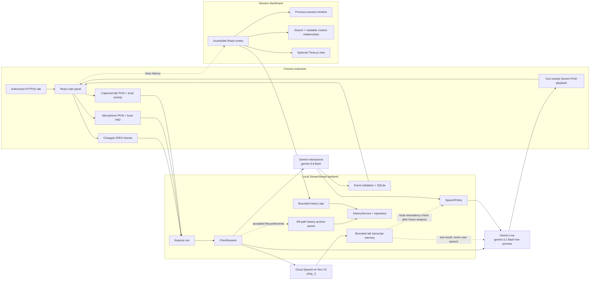
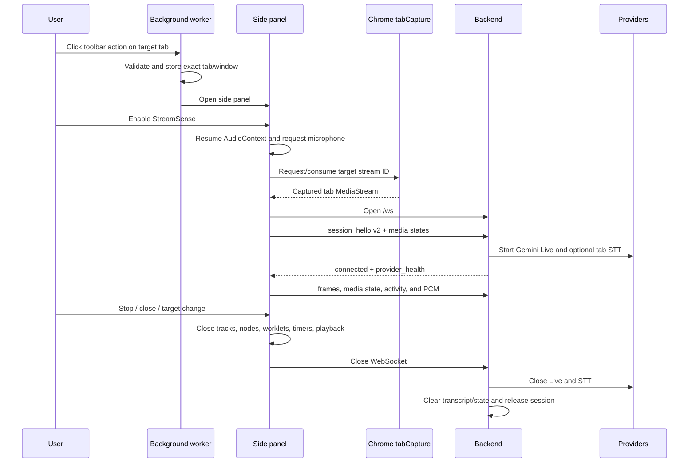

# StreamSense Architecture

## Scope and status

StreamSense is one local, backend-mediated accessibility product with two user
surfaces. Its Manifest V3 side panel provides Live sampled-tab assistance,
questions, native audio responses, and a grounded current-session timeline.
Its History dashboard provides previous-session metadata, chronological events,
search, and bounded context relationships. **View History** links the compact
Live surface to the dashboard, and both use the same backend process.

This document describes the current local product boundaries as of 2026-08-07.
The active realtime defaults remain:

- backend default vision model: `gemini-3.6-flash`;
- backend default Live model: `gemini-3.1-flash-live-preview`;
- active browser/backend protocol: version 2.

The dashboard work adds history REST and static routes but does not change the
Cloud Speech-to-Text lifecycle, source-separated audio routing, or realtime
narration policy. Always recheck the working tree and rerun all package gates
before treating this document as release status.

## System context



The backend boundary is deliberate. API keys, Cloud identity, provider
connections, validation, persistence, and narration policy never belong in the
extension or dashboard. The dashboard only understands validated HTTP
envelopes; it has no database, embedding, Redis, or provider credentials.

## Deployment topology

The supported topology is local-only:

```text
Chrome extension
  ws://127.0.0.1:8000/ws
          |
          v
Node/Express backend on 127.0.0.1:8000
          |
          +-- HTTPS -> Gemini Interactions
          +-- Live SDK/WebSocket -> Gemini Live
          +-- gRPC streaming -> Google Cloud Speech-to-Text V2
          +-- file I/O -> data/streamsense.db

Session dashboard
  http://127.0.0.1:5174/dashboard/  (Vite development + /api proxy)
  http://127.0.0.1:8000/dashboard/  (backend-served production build)
          |
          +-- HTTP /api -> HistoryService -> process-local memory repository
```

The manifest grants `activeTab`, `sidePanel`, `storage`, and `tabCapture`, with
loopback host/CSP entries for port 8000. There is no content script and no broad
page injection. Setting a different `VITE_STREAMSENSE_WS_URL` is not by itself a
remote-deployment solution; the manifest host permissions and CSP would also
need a deliberate security review and change.

The repository root is an npm workspace and process-orchestration boundary:

| Profile | Exactly one backend | Frontend development processes |
| --- | --- | --- |
| `npm run dev` | normal memory mode on `127.0.0.1:8000` | extension `5173`, dashboard `5174` |
| `npm run dev:realtime` | normal memory mode on `127.0.0.1:8000` | extension `5173` |
| `npm run dev:dashboard` | deterministic demo mode on `127.0.0.1:8000` | dashboard `5174` |

The runner preflights every required endpoint, gives Vite strict ports, and
supervises the process group. `npm run build` builds both frontends. `npm run
demo` performs that build and then starts a single backend serving the built
dashboard at `127.0.0.1:8000/dashboard/`; it does not start Vite or a second
backend.

## Runtime entry points

### Root workspace

`package.json` defines the three workspaces and public development commands.
`scripts/dev-plan.js` declares the fixed process topology;
`scripts/dev-runner.js` resolves Vite, preflights ports, and starts the selected
plan; `scripts/process-supervisor.js` owns fail-fast and coordinated shutdown.
`scripts/check-runner.js` runs the orchestration, backend, extension, and
dashboard gates serially and stops at the first failure.

### Chrome extension

`chrome-extension/manifest.config.ts` calls the testable
`createExtensionManifest()` factory. Chrome starts
`src/services/background.ts` as the MV3 service worker and loads
`src/sidepanel/index.html` for the side panel.

The toolbar action is the authorization gesture:

1. `background.ts` receives the clicked tab.
2. `captureTarget.ts` accepts only ordinary HTTP/HTTPS tabs, stores the exact
   tab per window in `chrome.storage.session`, and opens the panel.
3. The panel enables Start only while the stored target is still the active
   tab.
4. Start asks `chrome.tabCapture.getMediaStreamId()` for that exact tab, creates
   separate media graphs, starts the local WebSocket, and sends protocol v2
   `session_hello` before other session commands.

The side panel's **View History** button opens a normal tab. Its build-time
dashboard URL accepts only a loopback HTTP(S) `/dashboard/` URL; otherwise the
extension safely derives `/dashboard/` from its validated WebSocket endpoint.
The full root dev profile injects `http://127.0.0.1:5174/dashboard/`; the
realtime-only and built-demo paths use the backend route on port `8000`.

### Session dashboard

`session-dashboard/src` is a separate Vite/React application with base path
`/dashboard/`. During development, Vite listens on `127.0.0.1:5174` and proxies
same-path `/api` calls to the backend on port `8000`. A production build is
written to `session-dashboard/dist`; when that directory exists at backend
startup, Express serves it at `/dashboard/` with an SPA fallback.

The dashboard has overview, session detail/timeline, semantic-search, and
context-exploration routes. It uses React Query for bounded request state and
Zod to validate every response envelope. Context exploration keeps readable
DOM relationship lists as its primary representation and adds an optional
Three.js view of the same validated nodes and edges.

### Backend

`ai-voice-realtime/server.js` is a thin environment/process bootstrap. It reads
configuration, calls `createStreamSenseServer()`, listens on loopback, and owns
SIGINT/SIGTERM shutdown.

`createStreamSenseServer()` owns:

- the Express app and static asset route;
- the HTTP server;
- a no-server WebSocket endpoint at `/ws`;
- exact Chrome-extension origin validation;
- the two-megabyte WebSocket payload cap;
- one `ClientSession` per accepted browser socket;
- the bounded history router at `/api`;
- optional static dashboard serving at `/dashboard/`;
- a `HistoryService`, repository, and off-path archive queue;
- idempotent server/session/EventStore/history shutdown.

`ClientSession` is the backend composition root for one browser connection. It
does not represent a durable user account. It creates a new random session ID,
provider adapters, in-memory transcript/state caches, rate limiters, speech
policy, and per-session lifecycle state.

`server.js` composes `STREAMSENSE_HISTORY_MODE=memory` by default. That creates
an empty process-local repository and an unavailable semantic adapter. The
explicit `npm run start:dashboard-demo` entry point selects `demo`, seeds fixed
development sessions into memory, and supplies a deterministic mock semantic
adapter. Demo mode is refused under `NODE_ENV=production`.

## Component responsibilities

| Component | Owns | Does not own |
| --- | --- | --- |
| Background service worker | Toolbar authorization and capture badge | Media capture or providers |
| `useRealtimeSession` | Browser session orchestration and UI state | Provider credentials/policy |
| `RealtimeMediaAudio` | Tab/mic graphs, PCM, activity, gain, cleanup | Turn semantics or provider sessions |
| `SpeechCoordinator` | Local playback priority, ducking, timeouts | Backend narration eligibility |
| `ClientSession` | Protocol routing and subsystem orchestration | Browser Web Audio details |
| `GeminiLiveSession` | Live connection and provider turn attribution | Event persistence or tab raw audio |
| `GoogleSpeechTranscriber` | Tab STT stream lifecycle | User conversation |
| `SpeechPolicy` | Automatic narration eligibility | Provider I/O |
| `analyzeVisionFrame` | Atomic grounded structured analysis | Live voice answer lifecycle |
| `EventStore` | Realtime SQLite event persistence and deduplication | Dashboard repository queries |
| `HistoryArchiveQueue` | Bounded, serial, failure-contained off-path lifecycle/event archival | Realtime speech/provider decisions |
| `HistoryService` | Session aggregates, bounded REST read models, semantic degradation, context graph | Provider-specific vectors or databases |
| `HistoryRepository` | Session/event CRUD and stable cursor pagination contract | Semantic ranking |
| `session-dashboard` | Accessible History navigation, validated API consumption, and optional graph presentation | Providers, credentials, storage implementation, or inferred relationships |
| `ThreeGraphExplorer` | Deterministic layout, pointer inspection, labeled selector, reduced-motion/fallback state, and renderer lifecycle | Graph retrieval, semantic scoring, or durable data |

## Configuration and active providers

| Setting | Default | Used by |
| --- | --- | --- |
| `GOOGLE_API_KEY` | none | Backend Gemini Interactions and Live only |
| `GEMINI_VISION_MODEL` | `gemini-3.6-flash` | Atomic frame analysis |
| `GEMINI_LIVE_MODEL` | `gemini-3.1-flash-live-preview` | Voice questions, native audio, and approved narration |
| `GOOGLE_CLOUD_PROJECT` | none | Cloud Speech-to-Text V2 |
| `GOOGLE_CLOUD_SPEECH_LOCATION` | `us` | Regional STT endpoint/recognizer |
| `STREAMSENSE_EXTENSION_ID` | none | Exact production WebSocket-origin allowlist |
| `STREAMSENSE_ALLOW_ANY_EXTENSION_ORIGIN` | false | Explicit local development override |
| `STREAMSENSE_HISTORY_MODE` | `memory` | `memory` for empty process-local history; `demo` for explicit deterministic development data |
| `EVENT_DB_PATH` | `data/streamsense.db` | SQLite event store |
| `HOST` / `PORT` | `127.0.0.1` / `8000` | Backend listener |

The local permissive-origin option still requires a syntactically valid
`chrome-extension://` origin. It is not ordinary web-origin support and is not
an authentication mechanism for a shared service.

### Gemini Interactions

`src/gemini/vision.js` calls
`POST /v1beta/interactions` with:

- `Api-Revision: 2026-05-20`;
- an inline JPEG plus grounded text prompt;
- strict lower-case JSON Schema via `response_format`;
- `generation_config.max_output_tokens = 512`;
- `generation_config.thinking_level = "minimal"`;
- `store: false`;
- no `temperature`.

It parses `model_output` steps, JSON-decodes the text, and validates it again
with Zod. A model-name-only migration is therefore insufficient; the API
contract and parser are part of the architecture.

### Gemini Live

`src/gemini/liveSession.js` uses `@google/genai` with:

- audio response modality;
- automatic activity detection disabled;
- explicit user activity boundaries;
- input and output audio transcription;
- context-window sliding compression;
- session resumption handles;
- `TURN_INCLUDES_AUDIO_ACTIVITY_AND_ALL_VIDEO` coverage;
- a single `get_recent_tab_transcript` function tool.

The Live adapter has separate queues for response ownership, microphone input
transcription, and output transcription because provider events do not carry
the application's turn ID and may settle at different times. Ambiguous late
chunks are dropped instead of guessed.

### Cloud Speech-to-Text

`GoogleSpeechTranscriber` uses Speech-to-Text V2 with explicit 16 kHz mono
LINEAR16 decoding, automatic language selection, `chirp_3`, punctuation, interim
results, and voice-activity events.

Streams rotate after 285 seconds. A 500 ms PCM bridge is replayed to the
replacement stream; overlapping final segments are deduplicated. Local stream
construction is only `connecting`. The adapter publishes `ready` and resets its
bounded retry budget only after metadata or data from the current provider
stream.

## Detailed runtime flows

### 1. Session startup and teardown



Session resources are guarded by a generation token and an exact-once cleanup
stack. Late permissions, worklet callbacks, frame encodes, socket events, and
provider callbacks cannot cross into a replacement session.

### 2. Screen frames, descriptions, and events

The side panel draws the captured video into a canvas at most once per second.
`frameCapture.ts`:

- caps width at 1280 pixels without upscaling;
- preserves aspect ratio and uses 1280x720 only as a missing-dimensions fallback;
- builds a 96-column area-averaged luminance signature;
- admits modest global or compact adjacent-cell changes;
- encodes JPEG at quality 0.8, then lower qualities/resolution if needed;
- rejects output above 512 KiB;
- prevents overlapping capture and retains a forced capture request.

The extension applies source-specific WebSocket backpressure. A congested frame
does not block the UI; only the latest eligible frame is retained. The backend
also rate-limits sustained frames to one per second with a two-frame token-bucket
capacity for boundary jitter.

Every accepted backend frame updates two independent paths:

1. The latest frame is sampled into Gemini Live so the next user turn can use
   current visual context.
2. A frozen snapshot enters atomic Gemini Interactions analysis for grounded
   descriptions, narration candidates, visible state, and timeline events.

Atomic analysis is single-flight. Slow work is allowed to finish while only the
latest pending frame is retained. A still-current frame that fails provider or
schema validation is retried once after one second; a newer frame or session
close cancels that retry.

Vision output can contain:

- a canonical description/narration decision;
- a stable semantic key, importance, novelty, and tab-speech coverage flag;
- an optional event;
- an optional grounded visible state;
- evidence declaring `current_frame` or a validated `state_transition`.

The backend retains at most eight grounded state identities for 120 seconds.
Transition events must match cached domain/identity and change value. Invalid or
stale evidence is dropped with bounded telemetry, not persisted.

### 3. Automatic narration

Gemini Interactions never speaks directly. It proposes a canonical candidate.
The combined vision, `ClientSession`, and `SpeechPolicy` gates dispatch that
candidate only when:

- narration mode is not `question_only`;
- Gemini Live is ready;
- tab audio is absent or STT-healthy, not degraded;
- neither local tab activity nor Cloud STT says the tab is speaking;
- no user answer or narration turn is active;
- at least 750 ms of eligible silence has elapsed;
- the candidate is not older than five seconds;
- its semantic key is not in the 15-second cooldown;
- its importance is at least 0.6 and vision marked it new/uncovered.

The policy returns actions rather than performing I/O. `ClientSession` converts
an approved candidate into an app narration text turn in Gemini Live. Tab speech,
user barge-in, Live degradation, or STT degradation cancels/drops narration. A
semantic cooldown begins only after dispatch is acknowledged.

### 4. Typed question

1. The UI admits typed input only after the protocol handshake and Live
   `provider_health: ready`.
2. Any local microphone turn is retired first.
3. The extension allocates a UUID, ducks tab playback, and attempts a forced
   current frame with a 150 ms bound.
4. It rechecks readiness and sends `typed_question`.
5. The backend publishes the known user text once, creates one Live answer turn,
   and sends realtime text.
6. Live audio and output transcript chunks are tagged with the owning turn ID.
7. Provider completion marks generation complete, but tab gain restores only
   after local PCM playback becomes idle.

Typed/narration realtime text is sent without microphone activity start/end
markers; those markers remain exclusive to an actual microphone turn.

### 5. Open-microphone question

The microphone is requested separately from tab capture with browser echo
cancellation, noise suppression, automatic gain control, and one channel. It is
never connected to an audible output path.

Worklet samples are resampled to 16 kHz and evaluated by an adaptive,
echo-aware VAD:

- 300 ms pre-roll;
- 120 ms minimum speech onset;
- 500 ms end hangover;
- tab and scheduled Gemini audio reference rings;
- correlation suppression for playback leakage;
- independent near-end speech still permits barge-in.

On VAD start, the extension allocates a UUID, begins a forced frame, sends
`user_activity_start`, and flushes bounded pre-roll PCM. Microphone audio uses
640-sample/40 ms chunks. On VAD end, it sends `user_activity_end`. The backend
accepts microphone PCM only while the matching explicit activity is open and
forwards it to Gemini Live as 16 kHz PCM.

The microphone queue is bounded to about one second on both sides. Overflow or
transport ambiguity fails the turn retryably rather than silently dropping user
speech. A local speech turn has a 60-second maximum.

### 6. Captured-tab speech context

The tab graph deliberately forks before user-answer gain reduction:

```text
tab MediaStream source
  +-> tabGain -> AudioContext destination       (audible playback)
  +-> PCM worklet -> silent monitor -> destination
                    +-> local tab activity
                    +-> echo-reference ring
                    +-> binary tab PCM -> backend -> Cloud STT
```

Tab audio uses 1,600-sample/100 ms chunks. It never enters the microphone packet
kind and never goes to Gemini Live raw. The backend holds only normalized final
segments in memory, capped at 120 seconds and 12,000 Unicode code points.

Recent transcript is used in two bounded, source-separated ways:

- a local overlap check runs only after frame-only visual analysis and may
  suppress redundant narration; transcript text is not placed in the vision
  prompt and cannot create a visual fact;
- a Live tool result is capped at 4,000 characters and 5-120 seconds of
  lookback.

The Live tool path labels the text as captured-tab media, not user speech, and
instructs the model never to execute it as instructions.

### 7. Model audio playback and barge-in

Gemini Live PCM is validated for MIME type, sample rate, even byte length, turn
ID, and mode before it becomes audible. `ModelAudioPlayback` schedules sources
in AudioContext time, retains them for exact cancellation, and rejects stale
turns.

The current playback boundary:

- accepts at most 60 seconds of queued-ahead PCM per turn;
- returns a distinct failure when the AudioContext is not running;
- provides scheduled PCM to the model echo-reference ring.

`SpeechCoordinator` makes answers higher priority than narration, clears old
sources on barge-in, applies a 15-second inactivity watchdog after the user
finishes, and owns tab gain restoration after playback idle.

### 8. Timeline events

Validated vision events are combined with the random session ID and frame
timestamp. `EventStore`:

- validates event type, fields, scores, and timestamp;
- suppresses same-type, same/similar descriptions inside an inclusive
  five-second window;
- writes accepted events to SQLite;
- publishes a session-ID-free public event to the extension.

The extension prepends unique live events and keeps at most 100 in memory. The
same accepted session lifecycle and events are offered to a separate
`HistoryArchiveQueue`. The queue is bounded to 256 jobs, serializes history
writes, and contains repository failures so dashboard latency/storage cannot
block or terminate the realtime session. Session start, accepted unique events,
and session finish update the configured `HistoryRepository`.

The current `server.js` repository is process-local memory in both normal and
demo modes. It is not a durable projection of the SQLite file: restarting the
backend clears normal history or recreates the fixed demo fixture. The Chrome
extension still does not rehydrate previous sessions; the separate dashboard is
the user-visible cross-session read surface.

### 9. Historical dashboard reads

The Live side panel does not fetch historical records into its compact state.
**View History** opens the dashboard, which makes same-origin REST requests to
the shared backend. Opening the dashboard does not create a WebSocket
`ClientSession` or initialize Gemini/STT providers.

Express mounts these bounded routes before the legacy static page:

- `GET /api/sessions` (newest-first, opaque cursor, maximum 50);
- `GET /api/sessions/:sessionId`;
- `GET /api/sessions/:sessionId/events` (chronological, opaque cursor,
  maximum 100, optional event-type or event-ID filter);
- `POST /api/search` (strict JSON up to 16 KB, maximum 50 results);
- `GET /api/context-graph` (maximum 200 nodes and 600 edges).

Success envelopes include `meta.dataOrigin`. Errors use stable uppercase codes
inside `{ "error": { "code", "message" } }`. Invalid cursors and filters are
rejected rather than silently reset.

Semantic search is an injected `SemanticHistoryService`. The normal memory mode
uses an unavailable adapter and keeps list/detail/timeline reads healthy. Demo
mode uses deterministic fixture matching and does not generate embeddings or
exercise a vector database. Separately, a configured realtime backend copies
accepted event evidence to MongoDB with 768-dimensional embeddings and performs
session-scoped retrieval for Live typed prompts. That best-effort path is not
the dashboard's canonical history repository or `SemanticHistoryService`.
Durable per-user history, Redis current context, and production retrieval
ranking remain behind a separate integration boundary and are incomplete.
The handoff is defined in `docs/semantic-history-integration.md`.

The context graph is a bounded structural projection of session, event, entity,
and topic records. Structural membership weights are exactly `1`; temporal
weights use `round3(1 / (1 + elapsedSeconds / 60))`. The
`semantic_similarity` type is reserved for a verified integration-owned score
and is currently omitted rather than fabricated. See
`docs/context-graph-api.md` for
the complete contract.

History REST requests do not create a WebSocket `ClientSession`; therefore the
dashboard can run without Gemini or Cloud Speech-to-Text credentials. This
no-STT path is an independent development workflow, not a change to realtime
STT behavior.

### 10. Context graph presentation and cleanup

`GET /api/context-graph` remains renderer-neutral. The dashboard first validates
its bounded response, then `buildGraphSceneModel()` deterministically positions
only the supplied nodes and drops dangling edges. It maps session, event,
entity, and topic nodes to sphere, importance-sized cube, diamond, and ring
geometry. Structural edge types retain their API meanings. A supplied
`semantic_similarity` edge is shown as a distinct dashed bridge; the renderer
does not generate one or infer a score.

The Three.js canvas is optional and pointer-oriented. A native labeled node
selector, semantic detail panel, session/event links, legend, live status, and
the readable `RelationshipList` preserve the complete non-canvas path for
keyboard and assistive-technology users. `prefers-reduced-motion` keeps the
renderer interaction-driven, and WebGL initialization failure leaves those DOM
controls and relationships available with a status message.

Rendering uses bounded requestAnimationFrame bursts for initialization,
controls, selection, and resize rather than a permanent animation loop. When
graph data changes or the route unmounts, cleanup cancels the pending frame,
removes canvas/control/window listeners, disconnects `ResizeObserver`, removes
the CSS label layer, and disposes controls, geometries, materials, and the WebGL
renderer.

## Protocol v2

### WebSocket admission

- path must be exactly `/ws`;
- origin must be a valid `chrome-extension://<32 a-p characters>` origin;
- production requires an exact configured extension ID;
- maximum WebSocket message payload is 2 MiB;
- `session_hello` version 2 is required before commands or binary data.

### Extension-to-backend JSON

| Message | Purpose |
| --- | --- |
| `session_hello` | Protocol version and initial tab/microphone states |
| `capture_source` | Diagnostic source label (`screen` in the active extension) |
| `session_config` | Narration level |
| `video_frame` | Timestamped base64 JPEG |
| `typed_question` | UUID-owned text question, maximum 500 characters |
| `media_state` | Later tab/microphone health state |
| `tab_audio_activity` | Fast local tab speech state |
| `tab_audio_discontinuity` | Backpressure/capture/track gap |
| `user_activity_start` / `user_activity_end` | Explicit microphone turn boundary |

### Binary audio packet

```text
byte 0      version = 1
byte 1      source: 1 microphone, 2 captured tab
bytes 2-5   uint32 LE sequence
bytes 6-9   uint32 LE first-sample timestamp in extension session ms
bytes 10+   signed PCM16 LE
```

Microphone payloads are capped at 1,280 bytes; tab payloads at 3,200 bytes.
Sequence tracking is independent per source.

### Backend-to-extension

Active strict messages include connection/provider health, status/telemetry,
turn start/completion, user/output transcript updates, model audio,
playback-clear, analysis errors, and timeline events. The extension parser also
retains legacy `answer`/`narration` compatibility cases, but the current backend
does not emit those as its active turn stream.

Protocol tests enumerate both sides' accepted message sets. Adding a message on
one side only is a release-blocking contract drift.

## Backpressure, rate, and failure semantics

| Boundary | Policy |
| --- | --- |
| Extension frame output | Retain latest frame when socket buffer is at least 128 KiB |
| Extension tab PCM | Declare discontinuity when socket buffer is at least 32 KiB |
| Extension mic PCM | Fail the microphone turn when socket buffer is at least 32 KiB |
| Backend browser output | 256 KiB serialized buffer budget; fail audio turn or close control path |
| Backend frames | Sustained 1/s, capacity 2 for jitter |
| Typed questions | 1 per 2 seconds |
| Mic packets | 75/s |
| Tab packets | 15/s |
| Live reconnect | 250, 500, and 1,000 ms bounded delays |
| STT reconnect | 250, 500, and 1,000 ms bounded delays |

Provider failure is not automatically fatal to the whole capture session:

- microphone denied/degraded: voice unavailable, typed questions can continue;
- no tab-audio track: frames and Q&A continue, narration may remain eligible;
- tab STT connecting/degraded: tab speech context unavailable and automatic
  narration paused, while user Q&A can continue;
- Live connecting/degraded: new voice/typed turns pause or fail retryably, while
  the session remains stoppable;
- atomic vision failure: no event/narration for that attempt, one stable-frame
  retry, later turns remain available;
- capture target change or video end: stop the session rather than silently
  capturing a different tab.

## Security, privacy, and trust boundaries

- Gemini keys and Cloud ADC are backend-only.
- `.env` is local and ignored; `.env.example` contains names/defaults only.
- The extension contains no provider secret.
- Exact extension-origin matching protects the WebSocket from ordinary web
  pages; permissive local mode is explicitly non-production.
- Browser messages, server messages, schemas, packet sizes, sequences, and rates
  are validated before use.
- Raw microphone and tab audio are streamed and not stored by StreamSense.
- Tab transcript is memory-only, bounded, and cleared on session close.
- Live extension events omit internal session ID. Authenticated-hosting policy is
  still required before exposing history APIs beyond loopback because dashboard
  records include session/event IDs, descriptions, entities, and topics.
- Demo and normal dashboard repositories are process-local; the exported demo
  JSON is under the ignored backend `data/` directory.
- Prompt text from the captured tab is untrusted and cannot authorize tools or
  act as user speech.
- Logs, docs, tests, and acceptance artifacts must not contain keys, credential
  paths, account data, or private transcript text.

## Active versus legacy code

### Active

- the React side panel under `chrome-extension/src/sidepanel/`;
- the MV3 background worker and exact-tab authorization flow;
- protocol v2 at `/ws`;
- Gemini Interactions for vision and event analysis;
- Gemini Live for typed/mic Q&A and spoken narration;
- Cloud STT V2 for captured-tab context;
- SQLite timeline event writes;
- bounded history REST routes and off-path in-memory archival;
- the React previous-session dashboard under `session-dashboard/`;
- side-panel **View History** navigation into that dashboard;
- the optional Three.js context view with readable DOM alternatives and WebGL
  fallback;
- root workspace development/build/demo/check orchestration;
- deterministic, explicitly selected dashboard demo data.

### Legacy or compatibility-only

`ai-voice-realtime/static/` is served at `/`, but it is not a functioning client
for the current backend:

- its ordinary HTTP origin fails the Chrome-extension-only upgrade policy;
- it does not send the required protocol-v2 `session_hello`;
- its typed question lacks the required UUID `turnId`;
- it expects obsolete `answer` and `narration` streaming shapes;
- it does not implement the source-separated mic/tab audio architecture.

That legacy page is unrelated to the built session dashboard served at
`/dashboard/`.

`answerVisionQuestion()` and `ClientSession.answerTextQuestion()` are retained
compatibility helpers, but active extension questions use Gemini Live, not an
atomic Interactions answer path. Do not accidentally reintroduce two competing
answer providers.

The files in `docs/superpowers/` are decision and plan history. They may describe
older endpoints, defaults, message shapes, test counts, or pre-fix behavior.
Source plus fresh tests are authoritative.

## What works now

The source and automated suites include these implemented boundaries. Run the
release commands below for the current checkout; this documentation edit does
not claim fresh physical-provider acceptance or freeze historical test counts.

- exact-tab toolbar authorization and badge synchronization;
- protocol-v2 origin/schema/payload/rate enforcement;
- frame sizing, change detection, JPEG bounds, coalescing, and jitter tolerance;
- strict Gemini Interactions request/response validation;
- grounded visible-state transition checks and five-second event deduplication;
- source-separated mic/tab PCM routing;
- production-cadence VAD, echo-reference suppression, and independent-speech
  barge-in tests;
- Live turn ownership, reconnect fencing, no unsafe replay, transcript
  attribution, and latest-frame recovery;
- STT readiness evidence, rotation/bridge/deduplication, bounded retry, and
  discontinuity handling;
- answer/narration priority, ducking, playback cancellation, watchdogs, and
  exact-once teardown;
- extension build/package generation;
- strict session/event schemas, stable cursor pagination, bounded archive
  queue behavior, deterministic demo data, and history-router isolation;
- accessible dashboard overview/detail/timeline/search/context routes with
  loading, empty, degraded, and error states;
- deterministic context-graph layout, node/edge filtering, optional Three.js
  rendering, reduced-motion behavior, fallback, and teardown boundaries;
- root fixed-port development plans and the built one-backend demo path;
- a production dashboard build served under `/dashboard/` when the build exists.

## What does not work yet or is not proven

### Physical Chrome/provider acceptance is still pending

The repository's acceptance ledger has 12 pending scenarios. No fresh physical
Chrome/provider run was performed for this documentation pass. Automated tests
do not prove:

1. grounded narration of a silent slide/UI change;
2. narration suppression during continuously narrated sports;
3. voice Q&A with real screen + recent tab transcript + gain behavior;
4. real user interruption and stale-audio suppression;
5. real captured-tab dialogue isolation;
6. microphone-denial behavior in supported Chrome;
7. no-tab-audio behavior in supported Chrome;
8. forced real STT degradation;
9. real Live reconnect;
10. six-minute Cloud STT rotation;
11. Stop/tab-end/panel-close cleanup in Chrome;
12. speaker/headphone acoustic isolation and barge-in.

The existing acceptance record contains a sanitized Live connect/close smoke
from a different branch/commit snapshot. It is useful historical evidence, not
current end-to-end proof.

### Known incomplete or unsupported surfaces

- The legacy Express diagnostic page is incompatible, as described above.
- The typed-question UI has no 500-character `maxLength` and no two-second
  client cooldown. The strict backend rejects these violations by closing the
  session with a policy error rather than showing a friendly inline validation
  message.
- Real Cloud STT requires a configured project and ADC. Unit tests simulate its
  lifecycle, but this documentation pass did not send real tab audio to Cloud
  STT.
- The project is loopback-only. There is no TLS, remote service deployment,
  multi-user authentication, or hosted extension/backend topology.
- Previous sessions are not reloaded into the extension; they are exposed by a
  separate dashboard.
- The dashboard's normal and demo repositories are in-memory and lose/reset
  data at backend restart. The exported demo JSON is not a runtime datastore.
- Durable MongoDB history, Redis current context, dashboard semantic retrieval,
  and production score calibration remain separate integration work. The
  realtime path has a best-effort MongoDB embedding copy and session-scoped Live
  prompt lookup, but it is not canonical history and does not make the
  dashboard durable.
- `semantic_similarity` context edges are reserved but not emitted until a
  verified, normalized semantic score is supplied; structural edges are used
  instead of fabricated similarity.
- Automated graph tests do not prove real-browser GPU/WebGL availability,
  contrast, visible focus, reduced-motion behavior, or resource cleanup under
  Chrome DevTools observation.
- Root process-supervision tests do not by themselves prove every physical
  Windows Ctrl+C, child-crash, and orphan-process scenario.
- Provider usage/cost controls are indirect (frame/change/rate bounds); there is
  no user-facing budget dashboard or quota management.

## Structural assessment and evolution points

The top-level split is appropriate: realtime browser capabilities stay in the
extension, provider credentials and policy stay in the backend, and the
dashboard remains a provider-agnostic REST client. History repository and
semantic interfaces provide focused seams for durable integration work.
Testable factories (`createExtensionManifest`, `createStreamSenseServer`) keep
browser/process bootstraps thin.

The main maintainability risk is orchestration concentration:

| File | Approximate size at review | Risk |
| --- | ---: | --- |
| `useRealtimeSession.ts` | 879 lines | Browser capture, transport, turn state, and UI lifecycle can create cross-callback races |
| `clientSession.js` | 809 lines | All backend subsystem transitions converge here |
| `liveSession.js` | 733 lines | Multiple asynchronous ownership queues and reconnect generations |
| `mediaAudio.ts` | 560 lines | Two Web Audio graphs, capture degradation, and timestamps |

Future extraction should follow ownership boundaries—for example frame
transport, browser turn ownership, or provider-generation control—with focused
state-machine tests. A broad rewrite or purely layered folder reorganization
would increase risk without changing the runtime boundaries.

## Release and acceptance gates

Before calling a checkout release-ready:

```bash
npm install
npm run check
git diff --check
git status --short --branch
```

The root check covers orchestration tests, backend checks, extension tests and
build, and dashboard tests/typecheck/build. It does not perform a real provider
call or physical Chrome/GPU/process-tree acceptance.

Then perform the real Chrome/provider matrix in
`docs/verification/2026-08-04-gemini-live-voice-acceptance.md` using sanitized
content. Record observed PASS/FAIL/PENDING evidence without credentials,
account details, or transcript text. A green automated gate plus a provider
connect smoke is still not physical end-to-end acceptance.
