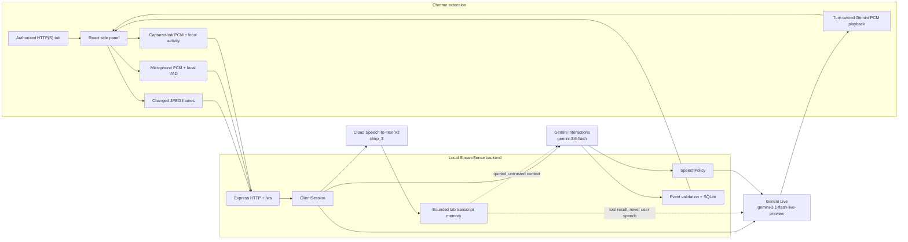
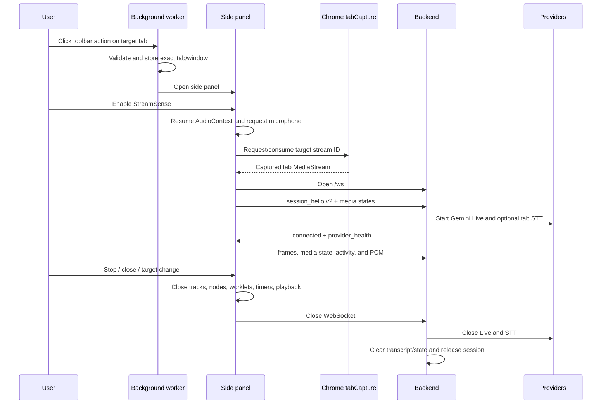

# StreamSense Architecture

## Scope and status

StreamSense is a local, backend-mediated realtime screen assistant built for a
Chrome Manifest V3 side panel. It combines sampled tab frames, open-microphone
questions, captured-tab speech context, Gemini native audio responses, and a
grounded event timeline.

This document describes the current working tree on 2026-08-05:

- branch: `ai-integration-v0`;
- HEAD: `7e0856e`;
- backend default vision model: `gemini-3.6-flash`;
- backend default Live model: `gemini-3.1-flash-live-preview`;
- active browser/backend protocol: version 2.

The checkout had six pre-existing uncommitted Live/audio files when this
document was created. The verification results below include those changes.
Always recheck Git state and rerun the gates before using this as a release
status report.

## System context



The backend boundary is deliberate. API keys, Cloud identity, provider
connections, validation, persistence, and narration policy never belong in the
extension.

## Deployment topology

The supported topology is local-only:

```text
Chrome extension
  ws://127.0.0.1:8000/ws
          |
          v
Node/Express backend on 127.0.0.1:8000
          |
          +-- HTTPS -> Gemini Interactions
          +-- Live SDK/WebSocket -> Gemini Live
          +-- gRPC streaming -> Google Cloud Speech-to-Text V2
          +-- file I/O -> data/streamsense.db
```

The manifest grants `activeTab`, `sidePanel`, `storage`, and `tabCapture`, with
loopback host/CSP entries for port 8000. There is no content script and no broad
page injection. Setting a different `VITE_STREAMSENSE_WS_URL` is not by itself a
remote-deployment solution; the manifest host permissions and CSP would also
need a deliberate security review and change.

## Runtime entry points

### Chrome extension

`chrome-extension/manifest.config.ts` calls the testable
`createExtensionManifest()` factory. Chrome starts
`src/services/background.ts` as the MV3 service worker and loads
`src/sidepanel/index.html` for the side panel.

The toolbar action is the authorization gesture:

1. `background.ts` receives the clicked tab.
2. `captureTarget.ts` accepts only ordinary HTTP/HTTPS tabs, stores the exact
   tab per window in `chrome.storage.session`, and opens the panel.
3. The panel enables Start only while the stored target is still the active
   tab.
4. Start asks `chrome.tabCapture.getMediaStreamId()` for that exact tab, creates
   separate media graphs, starts the local WebSocket, and sends protocol v2
   `session_hello` before other session commands.

### Backend

`ai-voice-realtime/server.js` is a thin environment/process bootstrap. It reads
configuration, calls `createStreamSenseServer()`, listens on loopback, and owns
SIGINT/SIGTERM shutdown.

`createStreamSenseServer()` owns:

- the Express app and static asset route;
- the HTTP server;
- a no-server WebSocket endpoint at `/ws`;
- exact Chrome-extension origin validation;
- the two-megabyte WebSocket payload cap;
- one `ClientSession` per accepted browser socket;
- idempotent server/session/EventStore shutdown.

`ClientSession` is the backend composition root for one browser connection. It
does not represent a durable user account. It creates a new random session ID,
provider adapters, in-memory transcript/state caches, rate limiters, speech
policy, and per-session lifecycle state.

## Component responsibilities

| Component | Owns | Does not own |
| --- | --- | --- |
| Background service worker | Toolbar authorization and capture badge | Media capture or providers |
| `useRealtimeSession` | Browser session orchestration and UI state | Provider credentials/policy |
| `RealtimeMediaAudio` | Tab/mic graphs, PCM, activity, gain, cleanup | Turn semantics or provider sessions |
| `SpeechCoordinator` | Local playback priority, ducking, timeouts | Backend narration eligibility |
| `ClientSession` | Protocol routing and subsystem orchestration | Browser Web Audio details |
| `GeminiLiveSession` | Live connection and provider turn attribution | Event persistence or tab raw audio |
| `GoogleSpeechTranscriber` | Tab STT stream lifecycle | User conversation |
| `SpeechPolicy` | Automatic narration eligibility | Provider I/O |
| `analyzeVisionFrame` | Atomic grounded structured analysis | Live voice answer lifecycle |
| `EventStore` | Validation-adjacent persistence and deduplication | Cross-session UI history |

## Configuration and active providers

| Setting | Default | Used by |
| --- | --- | --- |
| `GOOGLE_API_KEY` | none | Backend Gemini Interactions and Live only |
| `GEMINI_VISION_MODEL` | `gemini-3.6-flash` | Atomic frame analysis |
| `GEMINI_LIVE_MODEL` | `gemini-3.1-flash-live-preview` | Voice questions, native audio, and approved narration |
| `GOOGLE_CLOUD_PROJECT` | none | Cloud Speech-to-Text V2 |
| `GOOGLE_CLOUD_SPEECH_LOCATION` | `us` | Regional STT endpoint/recognizer |
| `STREAMSENSE_EXTENSION_ID` | none | Exact production WebSocket-origin allowlist |
| `STREAMSENSE_ALLOW_ANY_EXTENSION_ORIGIN` | false | Explicit local development override |
| `EVENT_DB_PATH` | `data/streamsense.db` | SQLite event store |
| `HOST` / `PORT` | `127.0.0.1` / `8000` | Backend listener |

The local permissive-origin option still requires a syntactically valid
`chrome-extension://` origin. It is not ordinary web-origin support and is not
an authentication mechanism for a shared service.

### Gemini Interactions

`src/gemini/vision.js` calls
`POST /v1beta/interactions` with:

- `Api-Revision: 2026-05-20`;
- an inline JPEG plus grounded text prompt;
- strict lower-case JSON Schema via `response_format`;
- `generation_config.max_output_tokens = 512`;
- `generation_config.thinking_level = "minimal"`;
- `store: false`;
- no `temperature`.

It parses `model_output` steps, JSON-decodes the text, and validates it again
with Zod. A model-name-only migration is therefore insufficient; the API
contract and parser are part of the architecture.

### Gemini Live

`src/gemini/liveSession.js` uses `@google/genai` with:

- audio response modality;
- automatic activity detection disabled;
- explicit user activity boundaries;
- input and output audio transcription;
- context-window sliding compression;
- session resumption handles;
- `TURN_INCLUDES_AUDIO_ACTIVITY_AND_ALL_VIDEO` coverage;
- a single `get_recent_tab_transcript` function tool.

The Live adapter has separate queues for response ownership, microphone input
transcription, and output transcription because provider events do not carry
the application's turn ID and may settle at different times. Ambiguous late
chunks are dropped instead of guessed.

### Cloud Speech-to-Text

`GoogleSpeechTranscriber` uses Speech-to-Text V2 with explicit 16 kHz mono
LINEAR16 decoding, automatic language selection, `chirp_3`, punctuation, interim
results, and voice-activity events.

Streams rotate after 285 seconds. A 500 ms PCM bridge is replayed to the
replacement stream; overlapping final segments are deduplicated. Local stream
construction is only `connecting`. The adapter publishes `ready` and resets its
bounded retry budget only after metadata or data from the current provider
stream.

## Detailed runtime flows

### 1. Session startup and teardown



Session resources are guarded by a generation token and an exact-once cleanup
stack. Late permissions, worklet callbacks, frame encodes, socket events, and
provider callbacks cannot cross into a replacement session.

### 2. Screen frames, descriptions, and events

The side panel draws the captured video into a canvas at most once per second.
`frameCapture.ts`:

- caps width at 1280 pixels without upscaling;
- preserves aspect ratio and uses 1280x720 only as a missing-dimensions fallback;
- builds a 96-column area-averaged luminance signature;
- admits modest global or compact adjacent-cell changes;
- encodes JPEG at quality 0.8, then lower qualities/resolution if needed;
- rejects output above 512 KiB;
- prevents overlapping capture and retains a forced capture request.

The extension applies source-specific WebSocket backpressure. A congested frame
does not block the UI; only the latest eligible frame is retained. The backend
also rate-limits sustained frames to one per second with a two-frame token-bucket
capacity for boundary jitter.

Every accepted backend frame updates two independent paths:

1. The latest frame is sampled into Gemini Live so the next user turn can use
   current visual context.
2. A frozen snapshot enters atomic Gemini Interactions analysis for grounded
   descriptions, narration candidates, visible state, and timeline events.

Atomic analysis is single-flight. Slow work is allowed to finish while only the
latest pending frame is retained. A still-current frame that fails provider or
schema validation is retried once after one second; a newer frame or session
close cancels that retry.

Vision output can contain:

- a canonical description/narration decision;
- a stable semantic key, importance, novelty, and tab-speech coverage flag;
- an optional event;
- an optional grounded visible state;
- evidence declaring `current_frame` or a validated `state_transition`.

The backend retains at most eight grounded state identities for 120 seconds.
Transition events must match cached domain/identity and change value. Invalid or
stale evidence is dropped with bounded telemetry, not persisted.

### 3. Automatic narration

Gemini Interactions never speaks directly. It proposes a canonical candidate.
The combined vision, `ClientSession`, and `SpeechPolicy` gates dispatch that
candidate only when:

- narration mode is not `question_only`;
- Gemini Live is ready;
- tab audio is absent or STT-healthy, not degraded;
- neither local tab activity nor Cloud STT says the tab is speaking;
- no user answer or narration turn is active;
- at least 750 ms of eligible silence has elapsed;
- the candidate is not older than five seconds;
- its semantic key is not in the 15-second cooldown;
- its importance is at least 0.6 and vision marked it new/uncovered.

The policy returns actions rather than performing I/O. `ClientSession` converts
an approved candidate into an app narration text turn in Gemini Live. Tab speech,
user barge-in, Live degradation, or STT degradation cancels/drops narration. A
semantic cooldown begins only after dispatch is acknowledged.

### 4. Typed question

1. The UI admits typed input only after the protocol handshake and Live
   `provider_health: ready`.
2. Any local microphone turn is retired first.
3. The extension allocates a UUID, ducks tab playback, and attempts a forced
   current frame with a 150 ms bound.
4. It rechecks readiness and sends `typed_question`.
5. The backend publishes the known user text once, creates one Live answer turn,
   and sends realtime text.
6. Live audio and output transcript chunks are tagged with the owning turn ID.
7. Provider completion marks generation complete, but tab gain restores only
   after local PCM playback becomes idle.

In the current uncommitted working tree, typed/narration realtime text is sent
without microphone activity start/end markers. Focused tests cover this provider
contract, but it is not yet a committed release baseline.

### 5. Open-microphone question

The microphone is requested separately from tab capture with browser echo
cancellation, noise suppression, automatic gain control, and one channel. It is
never connected to an audible output path.

Worklet samples are resampled to 16 kHz and evaluated by an adaptive,
echo-aware VAD:

- 300 ms pre-roll;
- 120 ms minimum speech onset;
- 500 ms end hangover;
- tab and scheduled Gemini audio reference rings;
- correlation suppression for playback leakage;
- independent near-end speech still permits barge-in.

On VAD start, the extension allocates a UUID, begins a forced frame, sends
`user_activity_start`, and flushes bounded pre-roll PCM. Microphone audio uses
640-sample/40 ms chunks. On VAD end, it sends `user_activity_end`. The backend
accepts microphone PCM only while the matching explicit activity is open and
forwards it to Gemini Live as 16 kHz PCM.

The microphone queue is bounded to about one second on both sides. Overflow or
transport ambiguity fails the turn retryably rather than silently dropping user
speech. A local speech turn has a 60-second maximum.

### 6. Captured-tab speech context

The tab graph deliberately forks before user-answer gain reduction:

```text
tab MediaStream source
  +-> tabGain -> AudioContext destination       (audible playback)
  +-> PCM worklet -> silent monitor -> destination
                    +-> local tab activity
                    +-> echo-reference ring
                    +-> binary tab PCM -> backend -> Cloud STT
```

Tab audio uses 1,600-sample/100 ms chunks. It never enters the microphone packet
kind and never goes to Gemini Live raw. The backend holds only normalized final
segments in memory, capped at 120 seconds and 12,000 Unicode code points.

Recent transcript is used in two bounded ways:

- up to 2,000 recent characters in the atomic vision prompt to suppress or
  corroborate what is already visible;
- a Live tool result capped at 4,000 characters and 5-120 seconds of lookback.

Both paths explicitly label the text as captured-tab media, not user speech,
and instruct the model never to execute it as instructions.

### 7. Model audio playback and barge-in

Gemini Live PCM is validated for MIME type, sample rate, even byte length, turn
ID, and mode before it becomes audible. `ModelAudioPlayback` schedules sources
in AudioContext time, retains them for exact cancellation, and rejects stale
turns.

The current uncommitted working tree:

- accepts at most 60 seconds of queued-ahead PCM per turn;
- returns a distinct failure when the AudioContext is not running;
- provides scheduled PCM to the model echo-reference ring.

`SpeechCoordinator` makes answers higher priority than narration, clears old
sources on barge-in, applies a 15-second inactivity watchdog after the user
finishes, and owns tab gain restoration after playback idle.

### 8. Timeline events

Validated vision events are combined with the random session ID and frame
timestamp. `EventStore`:

- validates event type, fields, scores, and timestamp;
- suppresses same-type, same/similar descriptions inside an inclusive
  five-second window;
- writes accepted events to SQLite;
- publishes a session-ID-free public event to the extension.

The extension prepends unique live events and keeps at most 100 in memory. The
database can list by internal session ID, but there is no current public history
endpoint or extension rehydration flow. Persistence therefore supports backend
records, not user-visible cross-session history yet.

## Protocol v2

### WebSocket admission

- path must be exactly `/ws`;
- origin must be a valid `chrome-extension://<32 a-p characters>` origin;
- production requires an exact configured extension ID;
- maximum WebSocket message payload is 2 MiB;
- `session_hello` version 2 is required before commands or binary data.

### Extension-to-backend JSON

| Message | Purpose |
| --- | --- |
| `session_hello` | Protocol version and initial tab/microphone states |
| `capture_source` | Diagnostic source label (`screen` in the active extension) |
| `session_config` | Narration level |
| `video_frame` | Timestamped base64 JPEG |
| `typed_question` | UUID-owned text question, maximum 500 characters |
| `media_state` | Later tab/microphone health state |
| `tab_audio_activity` | Fast local tab speech state |
| `tab_audio_discontinuity` | Backpressure/capture/track gap |
| `user_activity_start` / `user_activity_end` | Explicit microphone turn boundary |

### Binary audio packet

```text
byte 0      version = 1
byte 1      source: 1 microphone, 2 captured tab
bytes 2-5   uint32 LE sequence
bytes 6-9   uint32 LE first-sample timestamp in extension session ms
bytes 10+   signed PCM16 LE
```

Microphone payloads are capped at 1,280 bytes; tab payloads at 3,200 bytes.
Sequence tracking is independent per source.

### Backend-to-extension

Active strict messages include connection/provider health, status/telemetry,
turn start/completion, user/output transcript updates, model audio,
playback-clear, analysis errors, and timeline events. The extension parser also
retains legacy `answer`/`narration` compatibility cases, but the current backend
does not emit those as its active turn stream.

Protocol tests enumerate both sides' accepted message sets. Adding a message on
one side only is a release-blocking contract drift.

## Backpressure, rate, and failure semantics

| Boundary | Policy |
| --- | --- |
| Extension frame output | Retain latest frame when socket buffer is at least 128 KiB |
| Extension tab PCM | Declare discontinuity when socket buffer is at least 32 KiB |
| Extension mic PCM | Fail the microphone turn when socket buffer is at least 32 KiB |
| Backend browser output | 256 KiB serialized buffer budget; fail audio turn or close control path |
| Backend frames | Sustained 1/s, capacity 2 for jitter |
| Typed questions | 1 per 2 seconds |
| Mic packets | 75/s |
| Tab packets | 15/s |
| Live reconnect | 250, 500, and 1,000 ms bounded delays |
| STT reconnect | 250, 500, and 1,000 ms bounded delays |

Provider failure is not automatically fatal to the whole capture session:

- microphone denied/degraded: voice unavailable, typed questions can continue;
- no tab-audio track: frames and Q&A continue, narration may remain eligible;
- tab STT connecting/degraded: tab speech context unavailable and automatic
  narration paused, while user Q&A can continue;
- Live connecting/degraded: new voice/typed turns pause or fail retryably, while
  the session remains stoppable;
- atomic vision failure: no event/narration for that attempt, one stable-frame
  retry, later turns remain available;
- capture target change or video end: stop the session rather than silently
  capturing a different tab.

## Security, privacy, and trust boundaries

- Gemini keys and Cloud ADC are backend-only.
- `.env` is local and ignored; `.env.example` contains names/defaults only.
- The extension contains no provider secret.
- Exact extension-origin matching protects the WebSocket from ordinary web
  pages; permissive local mode is explicitly non-production.
- Browser messages, server messages, schemas, packet sizes, sequences, and rates
  are validated before use.
- Raw microphone and tab audio are streamed and not stored by StreamSense.
- Tab transcript is memory-only, bounded, and cleared on session close.
- Timeline events are persisted, but public events omit internal session ID.
- Prompt text from the captured tab is untrusted and cannot authorize tools or
  act as user speech.
- Logs, docs, tests, and acceptance artifacts must not contain keys, credential
  paths, account data, or private transcript text.

## Active versus legacy code

### Active

- the React side panel under `chrome-extension/src/sidepanel/`;
- the MV3 background worker and exact-tab authorization flow;
- protocol v2 at `/ws`;
- Gemini Interactions for vision and event analysis;
- Gemini Live for typed/mic Q&A and spoken narration;
- Cloud STT V2 for captured-tab context;
- SQLite timeline event writes.

### Legacy or compatibility-only

`ai-voice-realtime/static/` is served at `/`, but it is not a functioning client
for the current backend:

- its ordinary HTTP origin fails the Chrome-extension-only upgrade policy;
- it does not send the required protocol-v2 `session_hello`;
- its typed question lacks the required UUID `turnId`;
- it expects obsolete `answer` and `narration` streaming shapes;
- it does not implement the source-separated mic/tab audio architecture.

`answerVisionQuestion()` and `ClientSession.answerTextQuestion()` are retained
compatibility helpers, but active extension questions use Gemini Live, not an
atomic Interactions answer path. Do not accidentally reintroduce two competing
answer providers.

The files in `docs/superpowers/` are decision and plan history. They may describe
older endpoints, defaults, message shapes, test counts, or pre-fix behavior.
Source plus fresh tests are authoritative.

## What works now

Fresh automated verification on 2026-08-05 used Node `v24.15.0` and npm
`12.0.2`:

| Gate | Current result | What it establishes |
| --- | --- | --- |
| Backend `npm run check` | PASS: 232/232 tests | Syntax/imports, protocol, real loopback WebSockets, sessions, Interactions contract mocks, Live/STT state machines, events, and teardown |
| Extension `npm test` | PASS: 134/134 tests | Manifest, authorization, frames, audio separation, VAD/echo gates, playback, protocol, UI state helpers, and lifecycle |
| Extension `npm run build` | PASS | TypeScript and Vite production packaging; 3,122 modules transformed |

Based on those automated gates, the following are implemented and locally
verified at their test boundaries:

- exact-tab toolbar authorization and badge synchronization;
- protocol-v2 origin/schema/payload/rate enforcement;
- frame sizing, change detection, JPEG bounds, coalescing, and jitter tolerance;
- strict Gemini Interactions request/response validation;
- grounded visible-state transition checks and five-second event deduplication;
- source-separated mic/tab PCM routing;
- production-cadence VAD, echo-reference suppression, and independent-speech
  barge-in tests;
- Live turn ownership, reconnect fencing, no unsafe replay, transcript
  attribution, and latest-frame recovery;
- STT readiness evidence, rotation/bridge/deduplication, bounded retry, and
  discontinuity handling;
- answer/narration priority, ducking, playback cancellation, watchdogs, and
  exact-once teardown;
- extension build/package generation.

## What does not work yet or is not proven

### Physical Chrome/provider acceptance is still pending

The repository's acceptance ledger has 12 pending scenarios. No fresh physical
Chrome/provider run was performed for this documentation pass. Automated tests
do not prove:

1. grounded narration of a silent slide/UI change;
2. narration suppression during continuously narrated sports;
3. voice Q&A with real screen + recent tab transcript + gain behavior;
4. real user interruption and stale-audio suppression;
5. real captured-tab dialogue isolation;
6. microphone-denial behavior in supported Chrome;
7. no-tab-audio behavior in supported Chrome;
8. forced real STT degradation;
9. real Live reconnect;
10. six-minute Cloud STT rotation;
11. Stop/tab-end/panel-close cleanup in Chrome;
12. speaker/headphone acoustic isolation and barge-in.

The existing acceptance record contains a sanitized Live connect/close smoke
from a different branch/commit snapshot. It is useful historical evidence, not
current end-to-end proof.

### Known incomplete or unsupported surfaces

- The legacy Express diagnostic page is incompatible, as described above.
- The typed-question UI has no 500-character `maxLength` and no two-second
  client cooldown. The strict backend rejects these violations by closing the
  session with a policy error rather than showing a friendly inline validation
  message.
- Real Cloud STT requires a configured project and ADC. Unit tests simulate its
  lifecycle, but this documentation pass did not send real tab audio to Cloud
  STT.
- The project is loopback-only. There is no TLS, remote service deployment,
  multi-user authentication, or hosted extension/backend topology.
- SQLite events are not reloaded into the extension across sessions.
- Provider usage/cost controls are indirect (frame/change/rate bounds); there is
  no user-facing budget dashboard or quota management.
- The six pre-existing Live/audio edits pass tests but remain uncommitted, so
  the working tree is not a clean release candidate.

## Structural assessment and evolution points

The top-level split is appropriate: browser capabilities stay in the extension,
provider credentials and policy stay in the backend, and validation/persistence
have focused modules. Testable factories (`createExtensionManifest`,
`createStreamSenseServer`) keep browser/process bootstraps thin.

The main maintainability risk is orchestration concentration:

| File | Approximate size at review | Risk |
| --- | ---: | --- |
| `useRealtimeSession.ts` | 879 lines | Browser capture, transport, turn state, and UI lifecycle can create cross-callback races |
| `clientSession.js` | 809 lines | All backend subsystem transitions converge here |
| `liveSession.js` | 733 lines | Multiple asynchronous ownership queues and reconnect generations |
| `mediaAudio.ts` | 560 lines | Two Web Audio graphs, capture degradation, and timestamps |

Future extraction should follow ownership boundaries—for example frame
transport, browser turn ownership, or provider-generation control—with focused
state-machine tests. A broad rewrite or purely layered folder reorganization
would increase risk without changing the runtime boundaries.

## Release and acceptance gates

Before calling a checkout release-ready:

```bash
cd ai-voice-realtime
npm run check

cd ../chrome-extension
npm test
npm run build

cd ..
git diff --check
git status --short --branch
```

Then perform the real Chrome/provider matrix in
`docs/verification/2026-08-04-gemini-live-voice-acceptance.md` using sanitized
content. Record observed PASS/FAIL/PENDING evidence without credentials,
account details, or transcript text. A green automated gate plus a provider
connect smoke is still not physical end-to-end acceptance.
