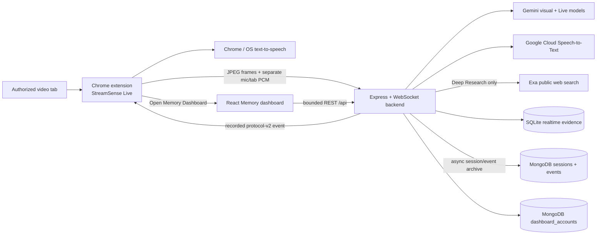

# StreamSense Architecture and Product Direction

This document is the current source of truth for component ownership, data
flow, persistence, accessibility, and near-term product boundaries.

## Product shape

StreamSense is one accessibility product with two connected surfaces:

1. **Live side panel** — immediate assistance beside an explicitly authorized
   stream.
2. **Memory dashboard** — a normal browser tab for reviewing, searching, and
   understanding the same saved sessions.



The toolbar action always opens Live. The dashboard handoff is an explicit Live
control. A connected backend returns the active session UUID, so the handoff can
target `/dashboard/sessions/{sessionId}`; without one it opens Memory overview.

## Live processing flow

The extension captures admitted frames, user microphone PCM, and captured-tab
PCM. The backend keeps the audio sources separate: the microphone represents the
user's question, while tab audio is transcribed into bounded commentary context.

Automatic narration follows a fail-closed sequence:

1. Analyze the admitted frame without treating prior generated prose as visual
   evidence.
2. Reject stale, unsupported, repeated, or self-referential output.
3. Compare the grounded visual fact with commentary only to suppress redundancy.
4. Persist the accepted event into SQLite.
5. Publish the exact recorded event to Live.
6. Let the side panel insert it into the timeline and offer that exact
   description to Chrome/OS TTS.

Typed and microphone questions use Gemini Live and interrupt timeline TTS before
question admission. Deep Research uses non-live Gemini requests and Exa, then
uses the existing Live session to speak the concise result. Deep Research
queries/sources are session-only and are not archived into Memory.

## Durable Live-to-Memory history

```text
grounded event
    |
    +--> SQLite EventStore
    |      fast local evidence; required before publication
    |
    +--> HistoryArchiveQueue
           asynchronous, bounded, retried, off the realtime path
                |
                +--> MongoDB sessions
                +--> MongoDB events
```

When `MONGODB_URI` is configured, MongoDB is the durable source for Memory.
`HistoryArchiveQueue` sends session start, accepted events, and session finish
to `MongoHistoryRepository` without blocking the realtime path.

The `events` collection is shared by two asynchronous writers:

- chronological history writes validated event fields and
  `historyArchived: true`;
- semantic enrichment writes the 768-dimensional embedding and semantic
  metadata.

Both writers upsert by the same event `id` and preserve one another's fields.
If their first inserts race, the duplicate-key loser retries as an ordinary
update. Memory ignores context-only documents until `historyArchived` is true.
This removes the former split where Memory lived in JavaScript Maps while
MongoDB held a separate semantic copy.

The `sessions` collection stores durable metadata and aggregates: start/end,
duration, title, domain, summary, entities/topics, event counts, and data origin.

## Storage selection

`STREAMSENSE_HISTORY_MODE` accepts:

- `auto` — default; use MongoDB when configured and reachable; an absent URI
  selects empty in-memory history, while a configured connection failure also
  emits a sanitized diagnostic before selecting that fallback;
- `mongodb` — require MongoDB and fail startup early for a missing URI or
  connection/DNS/authentication/TLS failure without exposing credentials;
- `memory` — no-Mongo/test fallback. A configured MongoDB still becomes the
  durable history source so an old local `memory` setting cannot split Live and
  Memory again.

Normal root `npm run dev`, `npm run dev:dashboard`, and `npm run demo` start
`server.js`. Synthetic history startup/export paths have been removed; only
automated test fixtures remain.

Atlas SRV resolution normally uses the host DNS resolver. An optional validated
`MONGODB_DNS_SERVERS` list can override the resolver inside the backend process
without changing system DNS or exposing the MongoDB connection string.

## Memory dashboard

Memory consumes bounded REST resources for session lists, details, events,
semantic search, and context graphs. It does not connect directly to Gemini,
Cloud STT, SQLite, MongoDB, or the realtime WebSocket.

The active session page polls its bounded REST resources every two seconds so a
newly archived Live event can appear. This is not a second realtime channel.
After backend restart, the same session remains because the API reconstructs it
from MongoDB.

Semantic search uses the same durable event documents. Query embeddings are
compared against event embeddings; results are joined to durable session
metadata and validated through the existing public schema.

## Relationship map

The relationship map is a semantic memory hierarchy:

```text
StreamSense Memory
  -> entertainment domain
      -> session
          -> chronological event
              -> entity/topic context
```

The largest sphere is the derived Memory root. Domain, session, event, and
context spheres become progressively smaller. In the multi-domain view, event X
is normalized stream progress, Y is supplied importance, and Z is the labeled
entertainment lane. Session-scoped single-lane views use the truthful progress ×
importance 2D projection.

The client renders only backend-supplied nodes and edges. It does not fabricate
semantic-similarity links. Canvas interaction always has a readable DOM node
selector, details, relationship list, reduced-motion behavior, and WebGL
fallback.

## MongoDB collections

| Collection | Purpose |
| --- | --- |
| `sessions` | Durable Memory session metadata and aggregates. |
| `events` | Durable chronological events plus optional embedding enrichment and vector-search fields. |
| `dashboard_accounts` | Prototype display name, email, and preference records. |

The account route is still a prototype profile, not production authentication.
Browser storage contains only the opaque account UUID. Current history is a
single-user/shared prototype and is not yet partitioned by account identity.

## Failure boundaries

- SQLite failure prevents publication and automatic narration of that event.
- Mongo history failure is retried, then reported as degraded history; it cannot
  retract a published SQLite-backed timeline event.
- Embedding/vector failure leaves chronological Memory history usable.
- Cloud STT failure degrades commentary context but not stored visual events.
- Gemini Live failure degrades questions/answers but Chrome timeline TTS remains
  separate.
- WebGL failure preserves readable Memory data.

## Accessibility

Accessibility is the default system behavior:

- semantic headings and landmarks;
- visible keyboard focus and skip link;
- screen-reader status, loading, empty, and error states;
- forced-colors and reduced-motion support;
- readable alternatives for every WebGL relationship;
- normal DOM session summaries and chronological timelines;
- visible controls corresponding to keyboard shortcuts.

## Development and verification

From the repository root:

```powershell
npm.cmd install
npm.cmd run dev
```

Ports are fixed: backend `8000`, extension Vite `5173`, and dashboard Vite
`5174`. The root runner starts exactly one backend and no synthetic history.
It runs that backend as a normal supervised process rather than Node watch
mode; any backend exit is observable, terminates the sibling Vite processes,
and makes the root command fail non-zero.

Before merge:

```powershell
npm.cmd run check
```

Physical acceptance additionally requires a configured MongoDB instance and
real Chrome/providers:

```text
create real Live session
-> persist accepted event
-> open exact Memory session
-> observe event and relationships
-> restart backend
-> verify session, timeline, search, and graph remain
```

Synthetic fixtures can support unit tests but must not be presented as judge
history. Preloaded finals history should be produced by the real StreamSense
capture pipeline.
