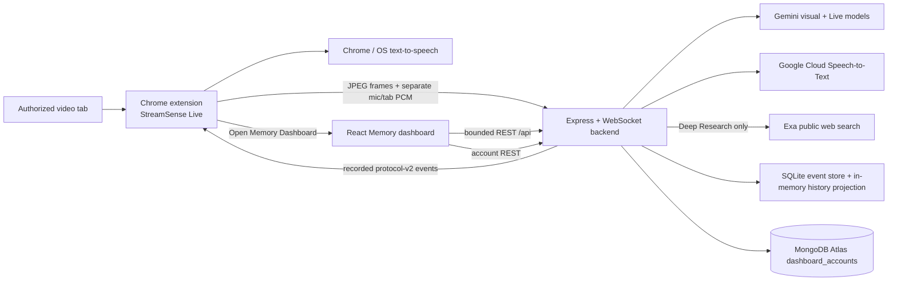

# StreamSense Architecture and Product Direction

This document is the current source of truth for component ownership, data
flow, persistence, accessibility, and near-term product ideas. Package-specific
contracts remain in their package READMEs and the focused documents in this
directory.

## Product shape

StreamSense is one accessibility product with two deliberately different
surfaces:

1. **Live side panel:** compact, immediate assistance beside the authorized
   stream.
2. **Memory dashboard:** a normal browser tab for reviewing, searching, and
   understanding saved moments.



The toolbar action always opens the side panel. The dashboard handoff is an
explicit option inside that panel. A connected backend returns the active
session UUID so the handoff can target `/dashboard/sessions/{sessionId}`;
without one it opens the Memory overview.

## Live processing flow

The extension captures admitted frames, user microphone PCM, and captured-tab
PCM. The backend keeps the two audio sources separate: the microphone represents
the user's question, while captured-tab audio is transcribed into bounded
commentary context.

Automatic narration follows a fail-closed sequence:

1. Analyze the admitted current frame without treating prior generated prose as
   visual evidence.
2. Reject stale, unsupported, repeated, or self-referential output.
3. Compare grounded visual facts with commentary only to suppress redundancy.
4. Persist and publish the accepted event to the current timeline.
5. Let the side panel deduplicate and insert the published event, then offer its
   exact recorded description to Chrome/OS text-to-speech.

Automatic timeline speech is owned by the extension's `chrome.tts` client, not
Gemini Live. The required Manifest V3 permission is `tts`, never `ttsEngine`;
the extension consumes installed Chrome/OS voices rather than providing an
engine. Timeline TTS prefers the lifecycle-capable English voices Alex, then
Samantha, then deterministic compatible English fallbacks. Every automatic
utterance supplies `en-US`, rate `0.9`, and pitch `0.9`; failed voice discovery
falls back to Chrome selection with those profile values. The side panel's
separate Voice narration preference controls only client-side timing and local
tab gain. Smart waits for 750 milliseconds of continuous silence from the
existing local tab-activity detector. Narrate over audio speaks immediately and
lowers only local tab playback to 40 percent from the Chrome TTS start event to
its terminal event. Narration only uses the same event-driven speech path while
keeping local tab playback muted for the capture session. Captured-tab PCM still
flows to its separate transcription path in every mode. The Narration level
preference remains responsible for description detail, and its Question only
value suppresses Chrome timeline TTS without suppressing timeline events.

Typed and microphone questions use Gemini Live and interrupt Chrome timeline
TTS before question admission. Gemini Live continues to own questions, answers,
and the existing Deep Research voice path, but never synthesizes automatic
timeline events. The fixed Chrome TTS voice profile does not change Gemini
Live's answer voice. Gemini Live or Cloud Speech-to-Text availability is
therefore not a gate for timeline TTS; Smart depends only on local tab activity.
Captured-tab audio is never presented as user speech.

Normal and Deep Research share one visible chat but have separate generation
paths. The selected mode is snapshotted per admitted question. Normal uses the
session's conversational Gemini Live path. Deep Research uses non-live
Gemini Interactions to resolve the query, Exa retrieves public passages, a second
Interaction produces the final cited answer, then the persistent Gemini Live
connection immediately speaks the concise answer body without its inline
citations or linked sources. The backend appends the readable source list
deterministically and streams strict progress events to the side panel
throughout. The Live connection remains open and resumes when
Normal is selected, preserving the Live context from before the research turn.
The search query, plan, sources, and answer remain
session-only and do not enter dashboard history or MongoDB.
Completed research turns retain only a bounded summary cache for the manual
debug replay button. That explicit action creates a separate Live audio turn,
suppresses its output transcript, and clears with the browser session.

## Memory dashboard

The dashboard consumes REST resources for session lists, session details,
events, semantic search, and context graphs. It does not connect to Gemini,
Cloud Speech-to-Text, or the realtime WebSocket directly.

The dashboard is a bounded workspace with a slim navigation rail. It reuses the
extension's tokens and Button/Input/Label/Select primitives at build time while
keeping wider-page layout and WebGL code dashboard-specific.

The relationship map is a semantic memory hierarchy:

```text
StreamSense Memory
  └─ Entertainment domain
      └─ Session
          └─ Chronological event
              ├─ Entity context
              └─ Topic context
```

The largest luminous sphere is a derived StreamSense Memory root. Progressively
smaller domain, session, event, and entity/topic spheres form the visual
hierarchy. Structural roots sit before the measured event region. Event X is
normalized stream progress from 0–100%, Y is supplied importance, and Z is a
labeled entertainment lane. Multiple sessions use bounded sub-lanes inside
their domain. Context is placed near the weighted centroid of its connected
events; cross-domain context falls between the lanes it actually connects.

Color, sphere size, surface treatment, depth, readable legends, and adjacent
text provide redundant meaning. With **All domains** selected, the overview
reserves the five canonical entertainment lanes and uses semantic 3D. Empty
lanes remain labeled scaffolding without API records; real unclassified history
adds a sixth Other entertainment lane. Explicit filters and session-scoped
single-lane maps default to the truthful progress × importance 2D projection.
Camera buttons name the comparisons they show rather
than raw axes, and there is no automatic animation. Selection reveals supplied
first-hop relationships, and the client never fabricates one. Each entertainment
lane has a faint progress-by-importance grid; root labels remain visible while
individual node labels are focus-disclosed and collision bounded. The node selector and
details appear below the full-width canvas, and full DOM relationship lists
remain the keyboard and screen-reader equivalent.

## Persistence and ownership

| Data | Current store | Lifetime and ownership |
| --- | --- | --- |
| Realtime accepted events | SQLite event store | Backend-local event evidence. |
| Semantic event copies | MongoDB `events` vector index | Best-effort, session-scoped context for Live typed prompts; not canonical dashboard history. |
| Dashboard session/history projection | In-memory repository | Lost on backend restart; demo mode is deterministic. |
| Dashboard profile | MongoDB Atlas `dashboard_accounts` | Primary cloud persistence for account UUID, display name, normalized email, preferences, and timestamps; local Docker is an optional offline substitute. |
| Browser profile state | Local storage | Opaque account UUID only. |
| Raw mic/tab audio | Not stored | Streamed for processing and discarded. |
| Captured-tab transcript context | Bounded memory | Cleared with the live session. |
| Deep Research query, sources, answer, and voice summary | Bounded request/session memory | Search and composition use non-live requests; the summary is spoken by Live and discarded with the session. Never archived or stored in MongoDB. |

The current account route is a prototype profile, not authentication. Signing
out forgets the local UUID but does not delete the Atlas record. The Atlas
database user and SRV credential belong only to the backend environment; they
are never browser credentials. Production identity, recovery, account deletion,
and per-user session authorization are future work.

## Accessibility and visual design

StreamSense targets blind and low-vision viewers, so accessibility is part of
the default system rather than an optional dashboard theme. The dashboard has
one shared visual treatment and retains:

- visible keyboard focus and a skip link;
- semantic headings, landmarks, status, error, loading, and empty states;
- keyboard shortcuts with visible equivalents;
- OS forced-colors and reduced-motion support;
- readable alternatives for every complex WebGL relationship;
- responsive reflow and content wrapping at narrow widths and browser zoom.

Current dashboard shortcuts are `Ctrl+K` for Memory search, `Alt+H` for the
Memory overview, `Alt+G` for the graph selector, and `Alt+/` for help. `Escape`
closes help and restores focus.

## Near-term product ideas

These are directions, not claims about the current build:

1. Start with one judge-ready sports or esports terminology pack, then add
   reviewed packs for concerts, product launches, and creator livestreams.
2. Add production identity, explicit retention/deletion controls, and per-user
   history ownership before treating profiles as accounts.
3. Replace in-memory session history with a durable repository while preserving
   the existing bounded history interface and REST contracts.
4. Add multilingual narration and user-controlled unfamiliar-term explanations.
5. Introduce creator-provided metadata and shared highlight links only after
   privacy and authorization rules are defined.
6. Keep a deterministic offline demo path and recorded backup for judging; do
   not replace provider failures with invented live output.

## Development and verification

From the repository root:

```powershell
npm.cmd install
npm.cmd run dev
```

Configure `MONGODB_URI` with an ignored MongoDB Atlas SRV connection string for
the primary dashboard-profile path. For offline work only, start the optional
local substitute with `docker compose up -d mongodb` and use the documented
loopback URI.

Use `npm.cmd run dev:dashboard` for deterministic Memory development without
the extension. Use `npm.cmd run check` as the full pre-commit gate.

More detail:

- `chrome-extension/README.md` — Live UI, capture, audio, and handoff.
- `ai-voice-realtime/README.md` — backend providers, policies, and APIs.
- `session-dashboard/README.md` — Memory routes, graph, accounts, and access.
- `docs/context-graph-api.md` — graph contract and renderer semantics.
- `docs/mongodb-atlas-handoff.md` — least-privilege teammate Atlas setup.
- `docs/semantic-history-integration.md` — history and retrieval boundary.
